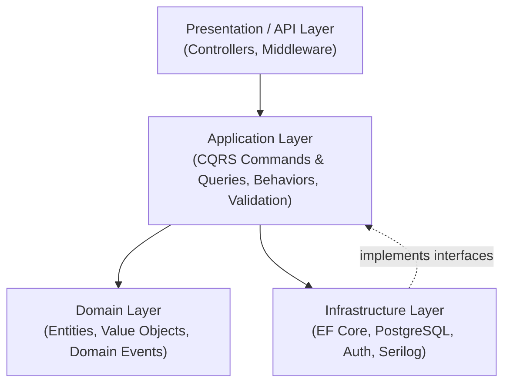

<div align="center">

# 🏛️ Enterprise Clean Architecture Template

### Enterprise-ready Clean Architecture solution template for ASP.NET Core with CQRS, MediatR, and Entity Framework Core

[](https://dotnet.microsoft.com/)
[](https://github.com/jbogard/MediatR)
[](https://learn.microsoft.com/ef/core/)
[](https://www.postgresql.org/)
[](LICENSE)

[Overview](#-overview) •
[Architecture](#-architecture) •
[What's Included](#-whats-included) •
[Tech Stack](#-tech-stack) •
[Repository Layout](#-repository-layout) •
[Quick Start](#-quick-start) •
[Testing](#-testing) •
[License](#-license)

</div>

---

## 📌 Overview

**Enterprise Clean Architecture Template** is a production-ready boilerplate built for **ASP.NET Core**, adhering to Domain-Driven Design (DDD) principles, the CQRS pattern, and strict architectural layer boundaries. It provides a robust, extensible foundation for enterprise backends with built-in validation, security, logging, and automated architecture tests.

### Key Highlights
- 🏛️ **Clean Architectural Boundaries**: Pure Domain layer with zero dependencies, encapsulated Application use cases, and modular Infrastructure.
- 📬 **CQRS with MediatR**: Structured command and query pipelines with cross-cutting behaviors (FluentValidation, performance profiling, error handling).
- 🔒 **Security & Identity**: JWT Bearer authentication paired with granular permission-based authorization.
- 📊 **Structured Logging & Telemetry**: Serilog integration with Seq log aggregation (`http://localhost:8081`).
- 🛡️ **Automated Architecture Tests**: NetArchTest suites enforcing layer dependencies and design rules in CI.

---

## 🏛 Architecture



> [!NOTE]
> Dependencies flow inward. The Domain layer remains completely independent of frameworks, databases, and third-party libraries.

---

## 📦 What's Included

- **`SharedKernel`**: Reusable DDD primitives (`Entity`, `AggregateRoot`, `ValueObject`, `DomainEvent`).
- **`Domain Layer`**: Pure business models and domain logic without external dependencies.
- **`Application Layer`**: MediatR CQRS handlers, FluentValidation pipeline behaviors, and result abstractions.
- **`Infrastructure Layer`**: EF Core migrations on PostgreSQL, JWT authentication, Seq structured logging, and outbox event publishing support.
- **`Testing Suites`**: Architecture tests verifying dependency isolation with NetArchTest alongside unit and integration tests.

---

## 🛠 Tech Stack

| Domain | Technologies |
| :--- | :--- |
| **Framework & Runtime** | .NET, ASP.NET Core, C# |
| **Messaging & CQRS** | MediatR, FluentValidation |
| **Persistence & Database** | Entity Framework Core, PostgreSQL |
| **Logging & Diagnostics** | Serilog, Seq |
| **Architecture Testing** | NetArchTest, xUnit |

---

## 📂 Repository Layout

```text
├── src/
│   ├── Presentation.Api/        # API controllers, program entry, middleware
│   ├── Application/             # CQRS handlers, commands, queries, validators
│   ├── Domain/                  # Core entities, value objects, domain logic
│   ├── Infrastructure/          # EF Core DbContext, PostgreSQL, JWT, Serilog
│   └── SharedKernel/            # Base DDD abstractions (Entity, AggregateRoot)
└── tests/                       # Unit, functional, and NetArchTest architecture suites
```

---

## 🚀 Quick Start

### Prerequisites
- [.NET SDK](https://dotnet.microsoft.com/download)
- [Docker Desktop](https://www.docker.com/)

### 1. Start Infrastructure via Docker
```bash
docker run -d --name postgres -p 5432:5432 -e POSTGRES_PASSWORD=postgres postgres:latest
docker run -d --name seq -p 8081:80 -e ACCEPT_EULA=Y datalust/seq:latest
```

### 2. Build and Run
```bash
dotnet restore
dotnet build
dotnet test
dotnet run --project src/Presentation.Api
```

---

## 🧪 Testing

```bash
# Run unit and architectural tests
dotnet test
```
Architecture tests enforce that the Domain layer has zero outer references and that presentation never references infrastructure directly.

---

## 👤 Author

**Md. Abul Kalam**
- GitHub: [@akazad13](https://github.com/akazad13)
- LinkedIn: [Md. Abul Kalam](https://linkedin.com/in/akazad13)

---

## 📄 License

This project is licensed under the [MIT License](LICENSE).
